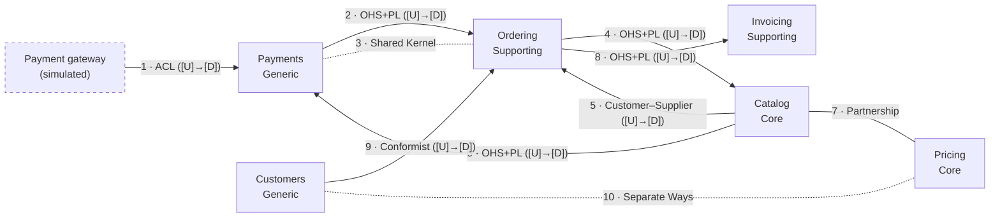
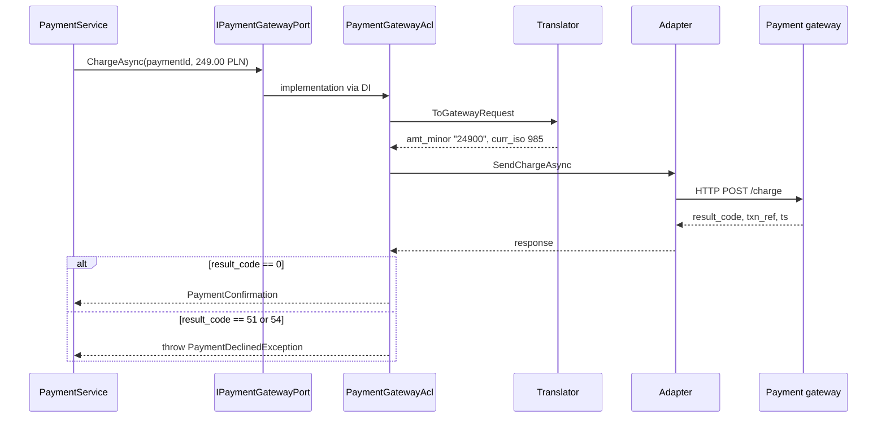

# Context Map – Shelfwise
 
## 1. Subdomain classification
 
| Context | Type | Aggregates | Justification | Microarchitecture |
|---|---|---|---|---|
| Catalog | Core | Product Batch, Product | Batches with expiry dates, FEFO and write-offs are what make Shelfwise different. | Rich Domain Model + Clean Architecture: six invariants from Lab 2. |
| Pricing | Core | Batch Price | Dynamic discounts by expiry date and sales speed are the main promise of Shelfwise. | Rich Domain Model + Clean Architecture: discount steps and minimum margin. |
| Ordering | Supporting | Cart, Order | Every shop has a cart and orders; no advantage. | Transaction Script: a simple flow with few rules. |
| Invoicing | Supporting | Invoice | Required by law, the same in every shop. | Transaction Script: an invoice is built from the confirmed order data. |
| Payments | Generic | Payment | Handled by an external payment gateway. | Transaction Script + adapter behind a port: a thin model, the gateway does the real work. |
| Customers | Generic | Customer | Registration and identity are solved the same way everywhere. | Transaction Script / Active Record: plain customer data, no business rules. |
 
## 2. Bounded Context Canvas: Catalog
 
| Field | Catalog |
|---|---|
| Purpose | Track batches with expiry dates, reserve the earliest-expiring stock first (FEFO), write off batches that cannot be sold. |
| Classification | Core; owner of stock and expiry data. |
| Ubiquitous Language | **Product Batch** – one delivery of a product with one expiry date · **Expiry Date** – last day the product can be sold · **Delivered Quantity** – items delivered · **Available Quantity** – delivered minus reserved · **Stock Reservation** – items held for one order · **FEFO** – first expired, first out · **Write-off** – removing a batch from sale (Expired, Damaged, Recalled) |
| Business rules | Expiry date later than today at registration · reservations never exceed delivered quantity · no reservation from an expired batch · a written-off batch is final |
| Incoming | Commands: Register batch, Reserve stock (on *Order placed*), Release reservation (on *Order cancelled*), Update current price (on *Price changed*), Mark batch as expired, Write off batch. Queries: Available stock per batch, Batches near expiry. |
| Outgoing | Events: Batch delivered, Stock reserved, Stock shortage detected, Stock reservation released, Batch expired, Batch written off |
| Dependencies | Ordering (order events), Pricing (price changes, stock data), Payments (*Stock reserved*). No external systems. |
 
## 3. Context Map
 

 
Arrows point from the upstream context [U] to the downstream context [D]. OHS+PL = Open Host Service + Published Language.
 
| # | Relationship | Pattern | Who dictates | Why | Main risk |
|---|---|---|---|---|---|
| 1 | Payment gateway [U] → Payments [D] | ACL | Payments | Gateway uses amounts as strings and numeric codes; its model is worse than ours. | Extra layer to maintain. |
| 2 | Payments [U] → Ordering [D] | OHS+PL | Payments | *Payment succeeded / rejected* confirm or cancel the order. | Missed event. |
| 3 | Ordering — Payments | Shared Kernel | Both | Only `Money` and `Currency` mean the same in both contexts. | Kernel grows into a shared monolith. |
| 4 | Ordering [U] → Catalog [D] | OHS+PL | Ordering | *Order placed / cancelled* trigger reserve and release. | Event versioning. |
| 5 | Catalog [U] → Ordering [D] | Customer–Supplier | Catalog | Ordering shows price, expiry date and stock; can request fields. | Catalog as a bottleneck. |
| 6 | Catalog [U] → Payments [D] | OHS+PL | Catalog | *Stock reserved* triggers Charge payment. | Event versioning. |
| 7 | Catalog — Pricing | Partnership | Both | Both Core: Pricing needs stock and expiry data, Catalog needs the new price. | One side blocks the other. |
| 8 | Ordering [U] → Invoicing [D] | OHS+PL | Ordering | *Order confirmed* triggers Issue invoice. | Backward compatibility. |
| 9 | Customers [U] → Ordering [D] | Conformist | Customers | Ordering uses `CustomerId` as Customers defines it. | Follows every Customers change. |
| 10 | Customers — Pricing | Separate Ways | Neither | Discounts are per batch, not per customer. | Personalised discounts need new integration. |
 
**Shared Kernel:** only `Money`, `Currency` and their exceptions. No entities.
 
## 4. Anti-Corruption Layer: Payment gateway → Payments
 
**Port** (`Shelfwise.Payments.Application/Ports`):
 
```csharp
public interface IPaymentGatewayPort
{
    Task<PaymentConfirmation> ChargeAsync(PaymentId paymentId, Money amount, CancellationToken ct);
}
 
public sealed record PaymentConfirmation(string GatewayReference, DateTimeOffset ChargedAt);
```
 
**ACL classes** (`internal sealed`, `Infrastructure/Acl`): `PaymentGatewayTranslator` (pure mapping), `PaymentGatewayAdapter` (HTTP call), `PaymentGatewayAcl` (implements the port).
 
| Foreign element | Our type | Rule |
|---|---|---|
| `amt_minor` `"24900"` + `curr_iso` `985` | **`Money`** (Lab 2) | 249.00 PLN; divide by 100, `InvariantCulture`; currency other than PLN/EUR → `PaymentIntegrationException` |
| `txn_ref` | `GatewayReference` | as is |
| `ts` (Unix seconds) | `DateTimeOffset` | `FromUnixTimeSeconds` |
| `result_code` `0` | `PaymentConfirmation` | success |
| `result_code` `51` / `54` | **`PaymentDeclinedException`** | domain exception: insufficient funds / expired card |
| `result_code` `91`, timeout, other | `PaymentIntegrationException` | technical failure, can be retried |
 

 