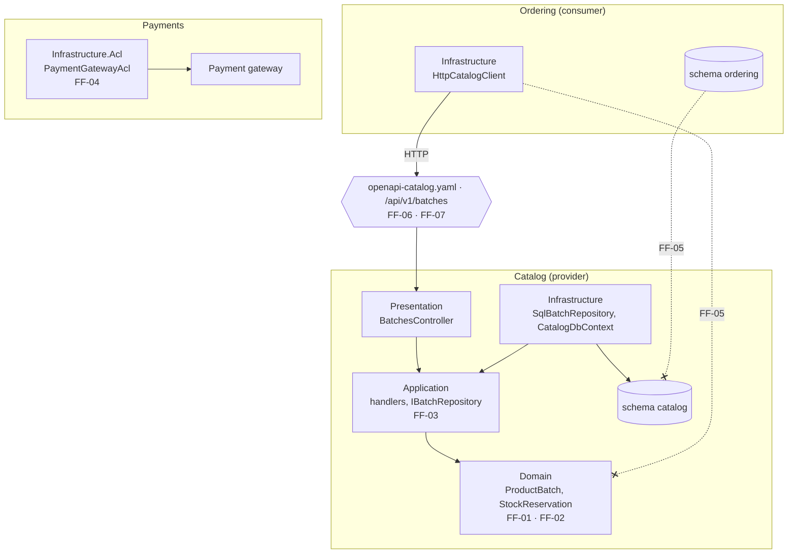

# Fitness Functions – Shelfwise

Architecture rules checked by tests. Main service: Catalog; consumer: Ordering.

## Static rules (inside a service)

| ID | Guard name | Scope (Layer / Namespace) | Verifiable rule (Technical predicate) | What AI / developer mistake does it stop? | Verification tool |
|---|---|---|---|---|---|
| FF-01 | Domain purity | `Shelfwise.Catalog.Domain` | No dependency on `Shelfwise.Catalog.Application`, `Shelfwise.Catalog.Infrastructure`, `Shelfwise.Catalog.Presentation`, `Microsoft.EntityFrameworkCore`, `Microsoft.AspNetCore`, `System.Net.Http`, `Confluent.Kafka`. No `PackageReference` in the csproj. | EF attributes (`[Table]`, `[Key]`) on `ProductBatch`, EF Core installed in Domain | NetArchTest.Rules |
| FF-02 | No public setters | All classes and records in `Shelfwise.Catalog.Domain` – aggregates, entities, Value Objects (`ProductBatch`, `StockReservation`); exceptions excluded | No property with a public setter (`init` allowed only in records). No public `List<T>` property; collections only as `IReadOnlyCollection<T>`. | `DeliveredQuantity { get; set; }` or a public reservations list – bypasses `Register` / `ReserveStock` and breaks: reservations ≤ delivered quantity, no reservation from an expired batch, written-off batch is final | Reflection (xUnit) |
| FF-03 | Application isolation | `Shelfwise.Catalog.Application` | No dependency on `Shelfwise.Catalog.Infrastructure`, `Shelfwise.Catalog.Presentation`, `Microsoft.EntityFrameworkCore`, `Microsoft.AspNetCore`. `*CommandHandler` / `*QueryHandler` are `internal sealed`. | Handler uses `CatalogDbContext` instead of `IBatchRepository`; controller depends on a concrete handler | NetArchTest.Rules |
| FF-04 | ACL boundary (Payments, Lab 3) | `Shelfwise.Payments.Infrastructure.Acl` | All types `internal`: `PaymentGatewayAcl`, `PaymentGatewayTranslator`, `PaymentGatewayAdapter`, `GatewayChargeRequestDto`, `GatewayChargeResponseDto`. `Shelfwise.Payments.Domain` and `Shelfwise.Payments.Application` do not depend on this namespace. `IPaymentGatewayPort` uses only `PaymentId`, `Money`, `PaymentConfirmation`. | Port returns `GatewayChargeResponseDto`; `result_code == 51` checked in `PaymentService` | NetArchTest.Rules |
| FF-05 | Service isolation | `src/Services/*` | `Shelfwise.Catalog.*` has no dependency on `Shelfwise.Ordering`, `Shelfwise.Pricing`, `Shelfwise.Payments`, `Shelfwise.Invoicing`, `Shelfwise.Customers` (same rule for every service); no cross-service `ProjectReference`. All `CatalogDbContext` entities in schema `catalog`; no shared tables; 0 foreign keys between schemas (`sys.foreign_keys`); no cross-schema joins. | `ProjectReference` from Ordering to `Shelfwise.Catalog.Domain`; FK `ordering.OrderLines.BatchId` → `catalog.ProductBatches.Id` | NetArchTest.Rules, SQL check, EF model check |

## Dynamic rules

| ID | Guard name | Condition / SLO | Where it runs |
|---|---|---|---|
| FF-06 | Contract compliance | 100% of `/api/v1/batches/*` requests and responses match `docs/contracts/openapi-catalog.yaml` (status codes, required fields, limits, `ProblemDetails` with `errorCode`) | CI integration tests (`WebApplicationFactory` + JSON Schema), Spectral; failure blocks the image |
| FF-07 | Reservation SLO | `POST /api/v1/batches/{batchId}/reservations`: p95 < 400 ms; 5xx < 0.5% (5-min window); same `Idempotency-Key` → `reservedQuantity` not increased again | k6 + integration test in CI; Prometheus alert in production |

## Guard placement

## CleanArchitectureGuardTests

| ID | Test method | Assembly anchor | Assert |
|---|---|---|---|
| FF-01 | `FF01_Domain_Should_Not_Depend_On_Other_Layers_Or_Frameworks` | `ProductBatch` | `ShouldNot().HaveDependencyOnAny(FF-01 list)` |
| FF-02 | `FF02_Domain_Types_Should_Not_Have_Public_Setters` | `ProductBatch` | no public setter (except `init` in records), no public `List<T>` |
| FF-03 | `FF03_Application_Should_Not_Depend_On_Infrastructure` | `IBatchRepository` | no FF-03 dependency; handlers not public, sealed |
| FF-04 | `FF04_Acl_Types_Should_Be_Internal` | `PaymentGatewayAcl` | no public type in `Shelfwise.Payments.Infrastructure.Acl`; no dependency on it from `Shelfwise.Payments.Domain` / `Shelfwise.Payments.Application` |
| FF-05 | `FF05_Catalog_Should_Not_Reference_Other_Services` | `ProductBatch`, `BatchService`, `CatalogDbContext` | no dependency on other `Shelfwise.*` services; all entities in schema `catalog` |

Failure message: rule ID + failing type names.

## Contract versioning

- Version in the path: `/api/v1/`.
- In v1 only compatible changes: new optional request field with a default, new response field, new endpoint.
- Rename / remove a field, change a type, add a required field → `/api/v2/` (expand–contract).
- Ordering reads only the fields it needs, ignores unknown fields, maps `status` with a default branch.
