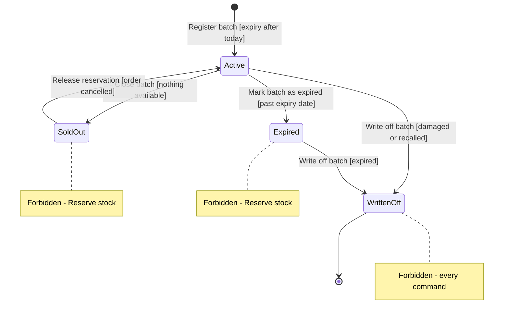

# State Diagram – Product Batch Lifecycle

Main aggregate: **Product Batch** (`ProductBatch`) in the **Catalog** bounded context.

Product Batch is the core of Shelfwise: every delivered batch has a quantity and an expiry date, orders reserve stock from it, and when it cannot be sold any more it is written off. The aggregate is already implemented in Lab 3 (`Register`, `ReserveStock`, `ReleaseReservation`). This document adds its full lifecycle, which the code does not model yet.

## 1. Lifecycle state machine

| State | Meaning |
|---|---|
| **Active** | The batch has been delivered and its stock can be reserved. |
| **SoldOut** | All delivered items are reserved: available quantity is 0. |
| **Expired** | The expiry date has passed, so the batch cannot be sold. |
| **WrittenOff** | The batch has been written off. Final state. |



### Transitions

| From | Command | Condition | To | Effect |
|---|---|---|---|---|
| – | Register batch | quantity above 0, expiry date after today | Active | Batch delivered |
| Active | Reserve stock | enough available stock | Active | Stock reserved |
| Active | Release reservation | – | Active | Stock reservation released |
| Active | Close batch | available quantity is 0 | SoldOut | Batch sold out |
| SoldOut | Release reservation | an order was cancelled | Active | Stock returns to sale |
| Active | Mark batch as expired | today is after the expiry date | Expired | Batch expired |
| Active | Write off batch | reason `Damaged` or `Recalled` | WrittenOff | All reservations released, Batch written off |
| Expired | Write off batch | reason `Expired` | WrittenOff | All reservations released, Batch written off |

### Forbidden operations

| State | Forbidden command | Domain exception |
|---|---|---|
| SoldOut | Reserve stock | `InsufficientStockException` |
| Expired | Reserve stock | `BatchExpiredException` |
| WrittenOff | every command (final state) | `BatchWrittenOffException` |

### Design decisions

- **SoldOut → Active.** When an order is cancelled, its reservation is released and the stock returns to sale. This follows the policy from the board: *Whenever an order is cancelled, release the stock reservation*.
- **Write-off before expiry.** A batch can be written off while still active if it is damaged or recalled by the producer. The write-off reason (`Expired`, `Damaged`, `Recalled`) is recorded, because for Shelfwise ("less waste") it matters whether a batch was wasted because it did not sell or because it was damaged. On the Lab 1 board, Write off batch appeared only after Batch expired; this extra transition was discovered during design and is added to the board as a hot spot.
- **Write-off releases all reservations.** Damaged goods cannot be delivered, so blocking the write-off would only make the system show stock that does not exist and accept new reservations for it. Instead, the aggregate releases all its reservations in the same transaction, and the **Batch written off** event lists the affected orders. The Ordering context then reacts with a policy: *Whenever a batch is written off, re-reserve stock from the next batch (FEFO)*. This follows Vernon's rule "one transaction, one aggregate": the `Order` aggregate is updated later through the event.
- **Simple status, not the State pattern.** With four states, an explicit status enumeration with checks in each method is enough. The State pattern would be over-engineering here.

## 2. Catalog of business invariants

Each rule below needs the current state of the aggregate (its reservations, its status or the registration date), so it cannot be checked from the request data alone.

| # | Aggregate | Business rule | Domain exception | Status |
|---|---|---|---|---|
| 1 | Product Batch | The expiry date must be later than today at the moment the batch is registered. | `InvalidExpiryDateException` | Implemented (Lab 3) |
| 2 | Product Batch | The total of all reservations never exceeds the delivered quantity. | `InsufficientStockException` | Implemented (Lab 3) |
| 3 | Product Batch | Stock cannot be reserved from an expired batch. | `BatchExpiredException` | Implemented (Lab 3) |
| 4 | Product Batch | A batch can be marked as expired only after its expiry date has passed. | `BatchNotYetExpiredException` | Planned |
| 5 | Product Batch | The write-off reason must match the state: `Expired` only for an expired batch, `Damaged` or `Recalled` for an active batch. | `InvalidWriteOffReasonException` | Planned |
| 6 | Product Batch | A written-off batch is final: no command is allowed. | `BatchWrittenOffException` | Planned |

The rule "quantity must be greater than zero" is not listed: it is input validation and lives in the `Quantity` Value Object (see `aggregates-and-invariants.md`).

## 3. Given–When–Then scenarios

"Today" is 2026-11-04 in all scenarios, as in the unit tests.

### Positive scenarios

**S1. Reserve stock when there is enough** (test: `ReserveStock_WhenEnoughStock_ReducesAvailableQuantityAndAddsReservation`)
- **Given** an active batch of 10 items, expiring on 2026-12-31, with no reservations.
- **When** order O-1 reserves 4 items.
- **Then** the batch has one reservation for O-1 with 4 items, the available quantity is 6, and the state stays **Active**.

**S2. A cancelled order brings a sold-out batch back to sale** (planned)
- **Given** a batch of 10 items in the **SoldOut** state: order O-1 has reserved all 10.
- **When** order O-1 is cancelled and Release reservation is called.
- **Then** the batch has no reservations, the available quantity is 10, and the state becomes **Active**.

**S3. Writing off a damaged batch releases its reservations** (planned)
- **Given** an active batch of 10 items, and order O-1 has reserved 4.
- **When** Write off batch is called with the reason `Damaged`.
- **Then** the state is **WrittenOff**, the batch has no reservations, and the Batch written off event lists order O-1, so Ordering can re-reserve stock from the next batch (FEFO).

### Negative scenarios

**S4. Reserving more than is available** (test: `ReserveStock_WhenQuantityExceedsAvailableStock_ThrowsInsufficientStockException`)
- **Given** an active batch of 10 items with 8 already reserved.
- **When** order O-2 reserves 5 items.
- **Then** `InsufficientStockException` is thrown (requested 5, available 2), and the reservations and available quantity stay unchanged.

**S5. Reserving from an expired batch** (test: `ReserveStock_WhenBatchHasExpired_ThrowsBatchExpiredException`)
- **Given** a batch expiring on 2026-11-07, and today is 2026-11-08.
- **When** order O-1 reserves 1 item.
- **Then** `BatchExpiredException` is thrown, and the batch has no reservations.

**S6. A command on a written-off batch (illegal transition)** (planned)
- **Given** a batch in the **WrittenOff** state.
- **When** order O-3 tries to reserve 2 items.
- **Then** `BatchWrittenOffException` is thrown, and the state stays **WrittenOff**.

| Scenario | Invariant | Transition |
|---|---|---|
| S1 | #2 | Active → Active |
| S2 | – | SoldOut → Active |
| S3 | #5 | Active → WrittenOff |
| S4 | #2 | forbidden in Active when stock is short |
| S5 | #3 | forbidden in Expired |
| S6 | #6 | forbidden in WrittenOff |

## 4. Design pattern: Factory Method

The constructor of `ProductBatch` is private, so the only way to create a batch is the static factory method `Register`. It checks the business rules first, so an incomplete or invalid batch can never exist. Its name comes from the Register batch command on the board, so it expresses the business intent instead of a technical `new`.

```csharp
public sealed class ProductBatch
{
    private ProductBatch(Guid id, Guid productId, int deliveredQuantity, DateOnly expiryDate)
    {
        
    }

    // Factory Method: Register batch -> Batch delivered
    public static ProductBatch Register(Guid productId, int quantity, DateOnly expiryDate, DateOnly today)
    {
        if (quantity <= 0)
            throw new InvalidQuantityException(quantity);

        if (expiryDate <= today)
            throw new InvalidExpiryDateException(expiryDate, today);

        return new ProductBatch(Guid.NewGuid(), productId, quantity, expiryDate);
    }
}
```

This pattern is already implemented in the Lab 3 code and covered by the tests `Register_WhenValidData_CreatesBatchWithFullAvailableStock`, `Register_WhenQuantityIsNotPositive_ThrowsInvalidQuantityException` and `Register_WhenExpiryDateIsNotInTheFuture_ThrowsInvalidExpiryDateException`.
